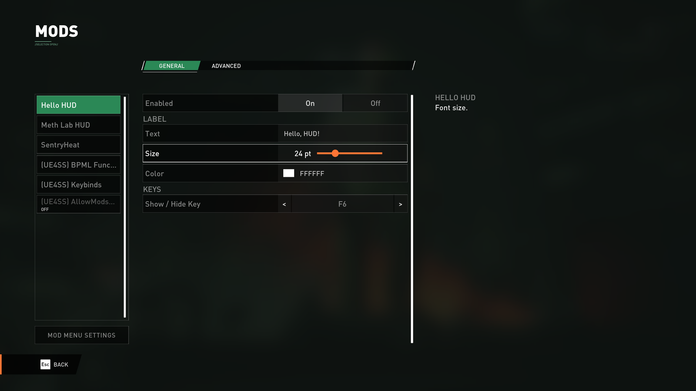

# Will's Mod Menu

An in-game settings menu for PAYDAY 3 UE4SS mods. It adds a **MODS** button to
the main menu and pause menu and opens a screen styled like the game's own
Settings, where players change any mod's `settings.ini` while the game runs.



- **Players:** download it from [Nexus Mods](https://www.nexusmods.com/payday3/mods/505) or from [Releases](https://github.com/Williscool13/WillsModMenu/releases).
- **Mod authors:** read [docs/AUTHOR_GUIDE.md](docs/AUTHOR_GUIDE.md). A mod that
  reads a `settings.ini` already works. You can introduce a schema that adds
  labels, limits, instant apply and a draggable HUD preview. [examples/HelloHUD](examples/HelloHUD) is a
  complete example mod.

Requires [UE4SS for PAYDAY 3](https://www.nexusmods.com/payday3/mods/266).
Tested with UE4SS v3.0.1 Beta.

## Layout

| Path | What |
|---|---|
| `WillsModMenu/` | The mod (dev build): `Scripts/main.lua`, `Scripts/screen.lua` |
| `lib/` | The ini and JSON libraries (single source; copied into the mod) |
| `examples/` | HelloHUD, plus the schemas of SentryHeat and Meth Lab HUD |
| `docs/` | Author guide, its screenshots, the game's measured UI style |
| `tests/` | Simulators (a fake engine in Python) for the menu and HelloHUD |
| `build_release.py` | Strips dev-only code, checks it, writes `release/WillsModMenu-<version>.zip` |

## Development

To try the dev build, copy `WillsModMenu/` into `PAYDAY3\PAYDAY3\Binaries\Win64\ue4ss\Mods\`.
Restart the game after changing the Lua files.

Release builds leave out development-only code: any line ending in `-- @dev`,
and everything between `-- @dev-begin` and `-- @dev-end`.

### Tests

Python 3 with [lupa](https://pypi.org/project/lupa/) (`pip install lupa`), run
from the repo root:

```
python tests/make_fake_mods.py <dir>                       # a fake Mods folder
python -I tests/modmenusim.py <dir> tests/<name>tail.lua   # one scenario
python -I tests/hellosim.py <scratch dir>                  # HelloHUD
python -I tests/initest.py                                 # ini library
python -I tests/jsontest.py                                # JSON library
```

`tests/*.ps1` are small Windows helpers used for in-game checks (screenshots,
clicks).

## Mods made for it

These ship a schema and apply changes live. Their repos show a complete setup.

- [SentryHeat](https://github.com/Williscool13/SentryHeat) ([Nexus](https://www.nexusmods.com/payday3/mods/497))
- [Meth Lab HUD](https://github.com/Williscool13/MethLabHUD) ([Nexus](https://www.nexusmods.com/payday3/mods/498))

## License

[MIT](LICENSE).
