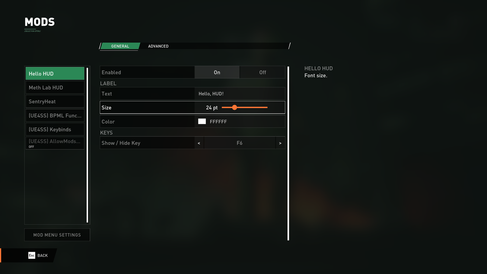
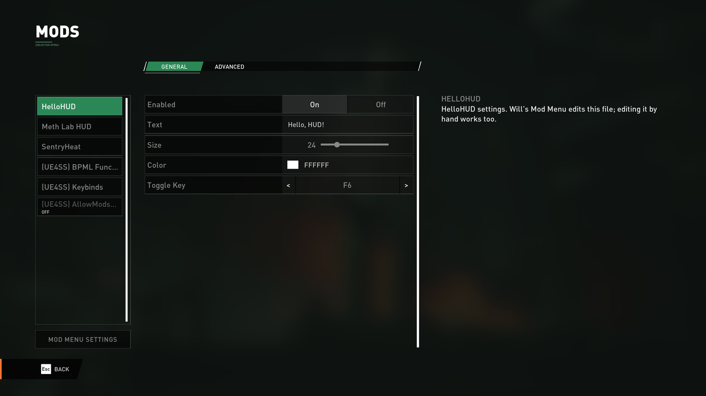
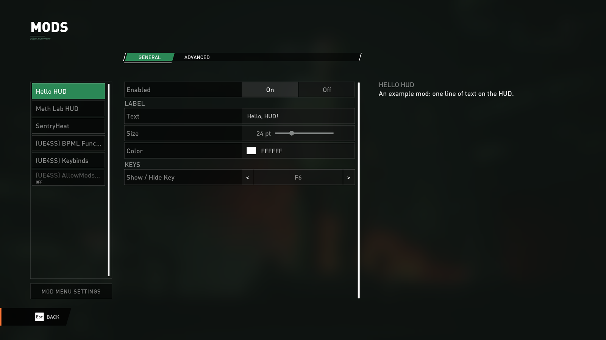
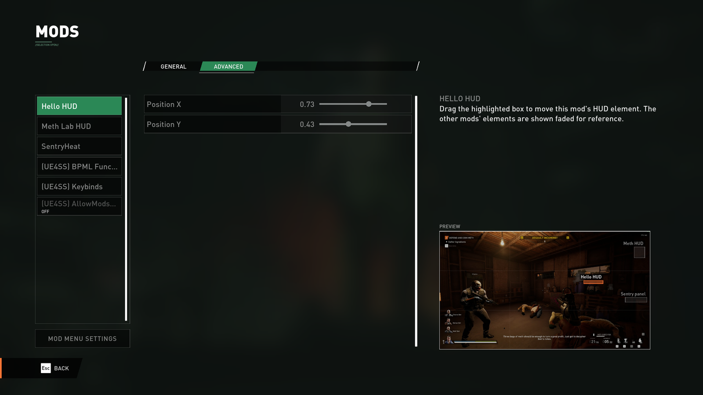
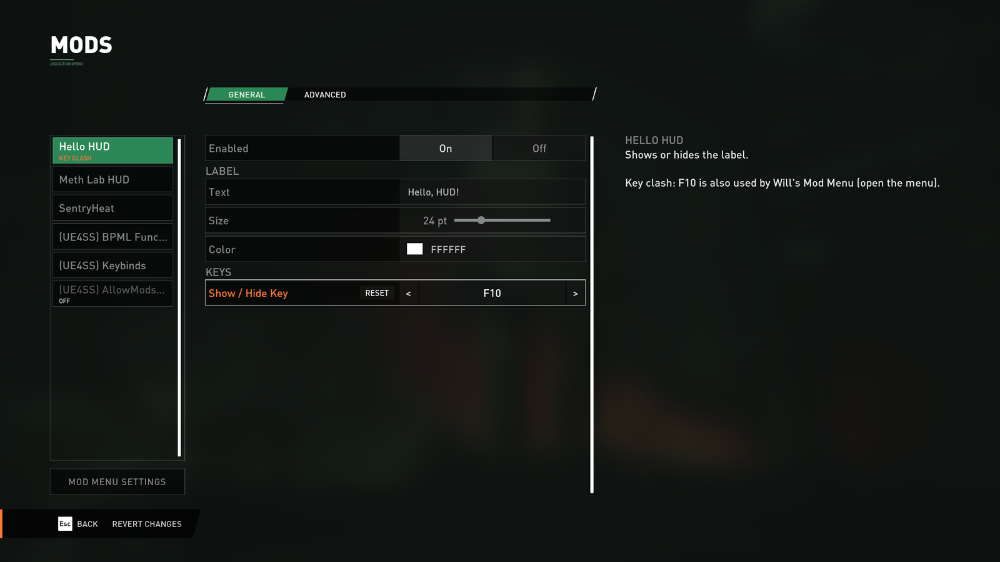
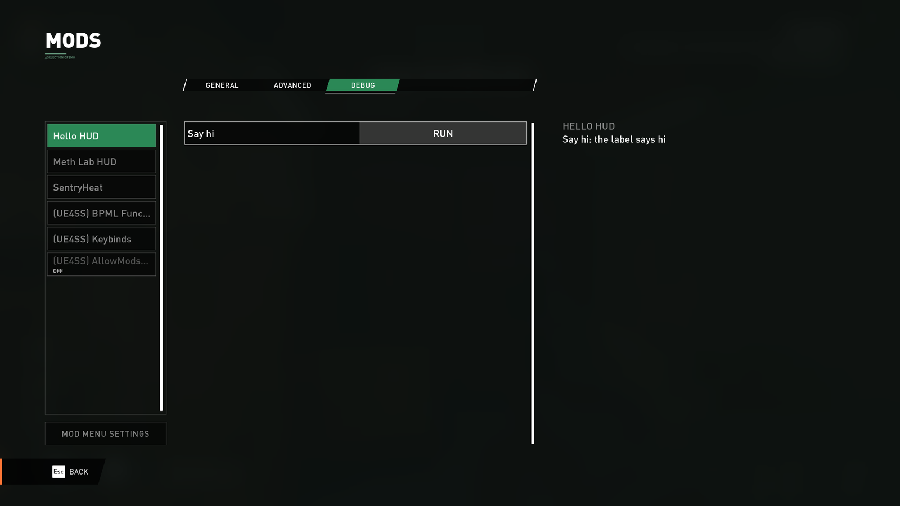

# Making your mod work with Will's Mod Menu

Will's Mod Menu adds a **MODS** button to PAYDAY 3's main menu and pause menu
(F10 works too). Players change any UE4SS mod's settings there, in a screen
styled like the game's own Settings.



**If your mod already reads a `settings.ini`, it already works.** Its settings
show up and can be changed. The steps below are optional.

- Your mod never depends on the menu: without it, nothing changes for players.
- The menu only edits your `settings.ini` (and renames your `enabled.txt` for
  its on/off switch). It never touches your code.

(The menu's folder is `WillsModMenu`. The shared variables mods use to talk to
it have generic `ModMenu.*` names, so any compatible menu could use them.)

---

## Quick start: HelloHUD

[`examples/HelloHUD`](../examples/HelloHUD) is a complete mod (one line of text
on the HUD). Each step below adds one thing.

### Step 1: A settings.ini

```ini
; HelloHUD settings. Will's Mod Menu edits this file; editing it by hand works too.

Text      = Hello, HUD!   ; what the label says
Size      = 24            ; font size
Color     = FFFFFF        ; text colour (RRGGBB)
ToggleKey = F6            ; show / hide the label

; --- Advanced ---
PanelX    = 0.5           ; label centre, fraction of screen width
PanelY    = 0.15          ; label centre, fraction of screen height
```

That's enough for a page. The menu guesses each control from the value
(`true`/`false` → On/Off, numbers → sliders, six hex digits → colour, names
ending in `Key` → key picker, anything else → a text field), uses the comments
as descriptions, and turns `; --- Advanced ---` into a second tab.



### Step 2: A schema for proper controls

Add `settings.schema.json` next to the ini. Every field is optional: describe
only what the guesses get wrong.

```json
{
  "schema": 0,
  "title": "Hello HUD",
  "description": "An example mod: one line of text on the HUD.",
  "settings": {
    "Text":      { "type": "text", "default": "Hello, HUD!" },
    "Size":      { "type": "number", "min": 10, "max": 60, "step": 1, "unit": "pt", "default": "24" },
    "Color":     { "type": "color", "default": "FFFFFF" },
    "ToggleKey": { "type": "key", "label": "Show / Hide Key", "default": "F6" },
    "PanelX":    { "type": "number", "min": 0, "max": 1, "step": 0.01, "label": "Position X", "default": "0.5" },
    "PanelY":    { "type": "number", "min": 0, "max": 1, "step": 0.01, "label": "Position Y", "default": "0.15" }
  }
}
```

Now the slider has the right range, the rows have friendly names, and each row
gets a **RESET** button (back to its `default`).



### Step 3: Apply changes without a restart

Until now, a change shows **RESTART NEEDED**: your mod read the file at
start-up. To apply it at once, mark the schema live and reread the file when the
menu says it changed:

```json
  "applies": "live",
```

```lua
-- The menu sets "ModMenu.changed.<YourFolder>" after every save.
local MM = { var = "ModMenu.changed.HelloHUD", seen = nil, at = 0 }
function MM.check()                       -- call this every frame from your loop
    local now = os.clock()
    if now < MM.at then return end
    MM.at = now + 0.5                     -- twice a second is plenty
    if ModRef == nil then return end
    local ok, v = pcall(ModRef.GetSharedVariable, ModRef, MM.var)
    if not ok or v == nil or v == MM.seen then return end
    MM.seen = v
    loadSettings()                        -- read settings.ini again
    apply()                               -- and update everything that uses it
end
```

What `apply()` does is up to your mod. In HelloHUD it sets the label's text,
size, colour, position and toggle key. Without the menu, the variable never
changes, so this costs one lookup twice a second.

Only ship `"applies": "live"` in a version of your mod that really rereads its
settings.

### Step 4: Let players drag the HUD element

If your mod draws something at a configurable position, add a `preview`. The
menu shows a small copy of the screen where the player drags it into place:

```json
  "preview": { "x": "PanelX", "y": "PanelY", "align": [0.5, 0.5], "size": [180, 32], "label": "Hello HUD" },
```



`x`/`y` are your position settings (fractions of the screen), `align` says
which point of your element that position is (`[0.5, 0.5]` = its centre,
`[1, 0.5]` = the middle of its right edge), and `size` is its size in UI units
of a 1920 × 1080 screen. Other mods' elements are shown faded.

The full files are in [`examples/HelloHUD`](../examples/HelloHUD).

---

## Reference

### settings.ini

- A setting is `Key = value`, optionally followed by `; description`. Keys are
  letters, digits and `_`, case-insensitive.
- `; --- Name ---` (three or more dashes) starts a new tab. Settings before the
  first one go in **General**.
- `; -- Name --` (two dashes) starts a sub-header inside the tab.
- The first comment line is your mod's description, unless the schema has one.
- Everything else (blank lines, other comments, alignment) is kept as it is.

### settings.schema.json: Top level

| Field | Meaning |
|---|---|
| `schema` | Format version: `0`. |
| `title` | The name in the mod list. Default: your folder name. |
| `description` | Shown when the player hovers your mod. |
| `applies` | `"restart"` (default) or `"live"` (step 3). |
| `preview` | Draggable HUD element(s) (step 4). Can be a list, one per element. Optional extras: `sizeKey` (a square size setting that overrides `size`), `description`. |
| `allowToggle` | `false` hides the menu's on/off switch for your mod. |
| `settings` | Per-setting fields, keyed by the name in `settings.ini`. |

### settings.schema.json: Per setting

| Field | Meaning |
|---|---|
| `type` | `toggle`, `number`, `choice`, `multi`, `color`, `key`, `text` (see below). |
| `label` | The row's name. Default: the key split into words (`EdgeWarning` → "Edge Warning"). |
| `description` | Shown on hover. Default: the ini comment. `\n` starts a new line. |
| `default` | What RESET puts back. No default, no RESET button. |
| `advanced` | `true` / `false`: put it in the Advanced / General tab regardless of the ini. |
| `group` | A sub-header inside the tab (same as `; -- Name --`). |
| `hidden` | `true`: never shown (developer settings). |
| `debug` | `true`: shown only in your DEBUG tab, when the player has turned the menu's Debug setting on (e.g. debug hotkeys). |
| `readonly` | `true`: shown, not changeable. `note` says why. |
| `mainMenuOnly` | `true`: locked during a heist (for settings read at heist start). |
| `applies` | `"live"` / `"restart"` for this setting only. |

| Type | Extra fields |
|---|---|
| `number` | `min`, `max`, `step` (also sets the decimals written), `unit`. |
| `choice` | `options` (values written), `labels` (`{ value: "shown text" }`). |
| `multi` | `options` (combinable, written comma-separated), `labels` (as for `choice`), `none` (written when nothing is picked; default `off`). |
| `color` | `RRGGBB`, typed by the player. |
| `key` | Picked from `NONE`, `F1`–`F12`, `Insert`, `Home`, `End`, `PageUp`, `PageDown`, `Delete`. |
| `toggle` | Writes `true` / `false`. |
| `text` | Typed by the player. `;` and line breaks aren't accepted. |

The menu looks for the schema in your mod's folder first, then in
`WillsModMenu\schemas\<YourFolder>.settings.schema.json` (empty by default; a
place for schemas of mods that ship none). A schema with a JSON error
shows a **PROBLEM** tag with the error. More examples:
[SentryHeat](../examples/SentryHeat.settings.schema.json) (choices, multi),
[Meth Lab HUD](../examples/MethCook.settings.schema.json) (groups, colours).

### The mod list

- **Every folder** in `ue4ss\Mods` is listed, with an **Enabled** On/Off switch
  (it renames `enabled.txt`; takes effect after a restart). Mods started from
  `mods.txt` don't get the switch.
- **PROBLEM**: the most common one is a mod unpacked one folder too deep. Pack
  your zip as `MyMod\Scripts\main.lua`, not `MyMod\MyMod\Scripts\main.lua`.
- **KEY CLASH**: two switched-on mods use the same key.



### Saving

Changes are written to `settings.ini` at once (no Save button), changing only
the value: comments, alignment and line endings stay byte for byte. Keep
accepting hand-edited files; the menu is never the only editor.

---

## Checklist

- [ ] `settings.ini` next to `Scripts\`, one `Key = value ; description` per line.
- [ ] Rarely used settings under `; --- Advanced ---`.
- [ ] (Optional) a schema with `title`, `description` and a `default` per setting.
- [ ] (Optional) `"applies": "live"` and `MM.check()`, if your mod can reread its settings.
- [ ] (Optional) `preview` for a HUD element at a configurable position.
- [ ] Zip packed as `MyMod\Scripts\main.lua`.

---

## Appendix: Debug actions

The menu has one setting of its own, **Debug** (MOD MENU SETTINGS, below the
mod list; off by default). With it on, mods that offer debug actions get a
**DEBUG** tab with a **RUN** button per action, in a heist.



| Shared variable | Set by | Value |
|---|---|---|
| `ModMenu.debug.<YourFolder>` | your mod | one line per action: `id<TAB>label<TAB>description` |
| `ModMenu.run.<YourFolder>` | the menu | `id#stamp` when RUN is pressed |
| `ModMenu.reply.<YourFolder>` | your mod | `id#stamp<TAB>result`, shown to the player |

The menu sends one request at a time and waits up to 3 seconds for the answer.
HelloHUD's section 4 is a working implementation (call `MM.debugCheck()` from
`MM.check()`). Keep debug actions out of release builds.

---

Tested with the PAYDAY 3 build of UE4SS 3.0.1 (UE5).
